# Jarvis Mailer — AI-Powered Mail Web Application

An AI-driven email web application built with **Django** where an embedded **Jarvis Co-Pilot** programmatically controls the user interface — navigating views, visibly filling compose forms, filtering the inbox, opening threads, and replying with full context awareness.

🔗 **Live Demo:** https://jarvis-mailer.vercel.app/

🎥 **Video Walkthrough:** [Watch on Google Drive](https://drive.google.com/file/d/1alsHlwThjvRA4NSp6Th8v0rBmeCq0LJc/view?usp=sharing)

📘 **Full Documentation:** [docs/PROJECT_DOCUMENTATION.md](docs/PROJECT_DOCUMENTATION.md)

---

## Features

- **Full Mail Client**: Inbox, Sent, Email Detail with **Thread / Conversation View**, Compose, Reply, Forward, and Mark Read/Unread.
- **AI Assistant that Controls the UI**:
  - **Compose & Visible Field Filling**: `"Send an email to john@example.com with subject 'Meeting Tomorrow' and body 'Let's meet at 3pm'"` opens Compose and animates filling `To`, `Subject`, and `Body` live.
  - **Human-in-the-Loop Confirmation**: Renders an interactive **Confirm & Send** card inside the assistant panel before sending.
  - **Search & Filter Driving the Main UI**: `"Show me emails from the last 10 days"`, `"Find the email from Sarah about the project update"`, `"Show only unread emails from this week"` query the backend and update both the main email list and the UI filter controls.
  - **Navigate & Open**: `"Open the latest email from David"` navigates directly to the email detail & thread view.
  - **Context Awareness**: `"Reply to this"` or `"Forward this to ..."` knows which email is currently open and pre-fills a threaded reply or forward.
  - **Rich UI Cards**: Clickable email preview cards and confirmation cards inside the assistant panel.
- **Real-Time Mail Sync**:
  - **Google Gmail API + Cloud Pub/Sub** webhook (`/api/webhooks/gmail/`) for incremental `historyId` sync.
  - **Server-Sent Events (SSE)** stream (`/api/mail/stream/`) pushes incoming emails to the browser without manual refresh.
  - Built-in **⚡ Simulate Push Email** button in Demo Mode to test real-time SSE delivery locally without a public tunnel.
- **Dark Mode & Polished Three-Pane UI**: Light/Dark theme.

---

## Screenshots

### Jarvis Co-Pilot in Action

| Co-Pilot Panel | Compose via Co-Pilot (Confirm & Send card) |
|---|---|
| 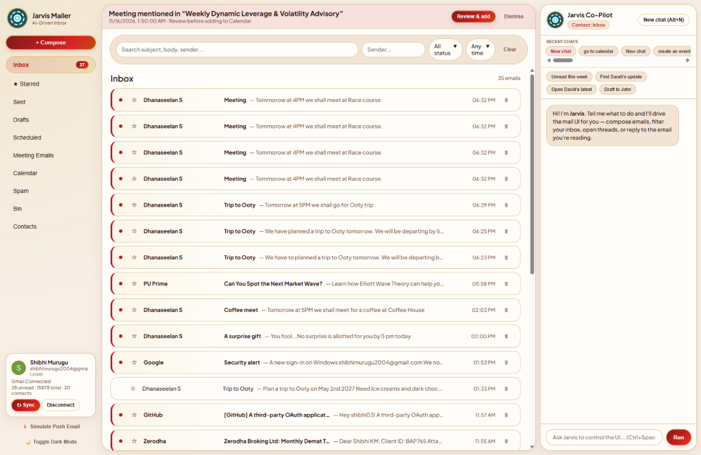 | 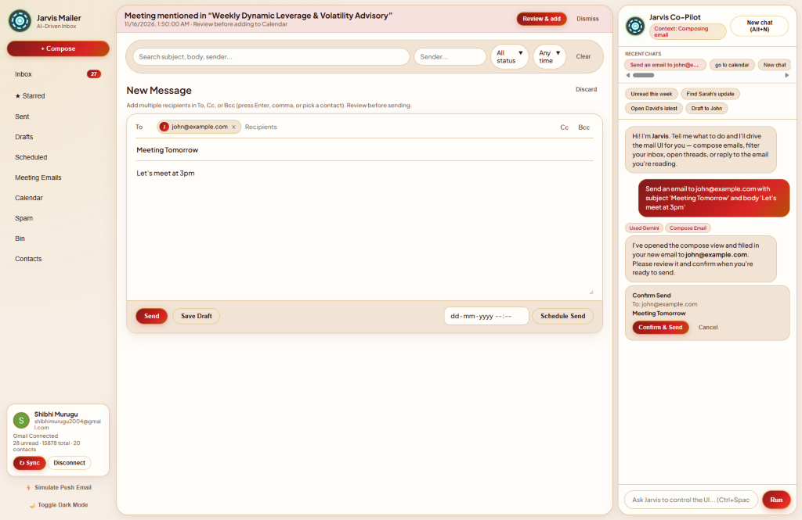 |
| **Filter: "Show only unread emails from this week"** | **Navigate: "Open the latest email from …"** |
| 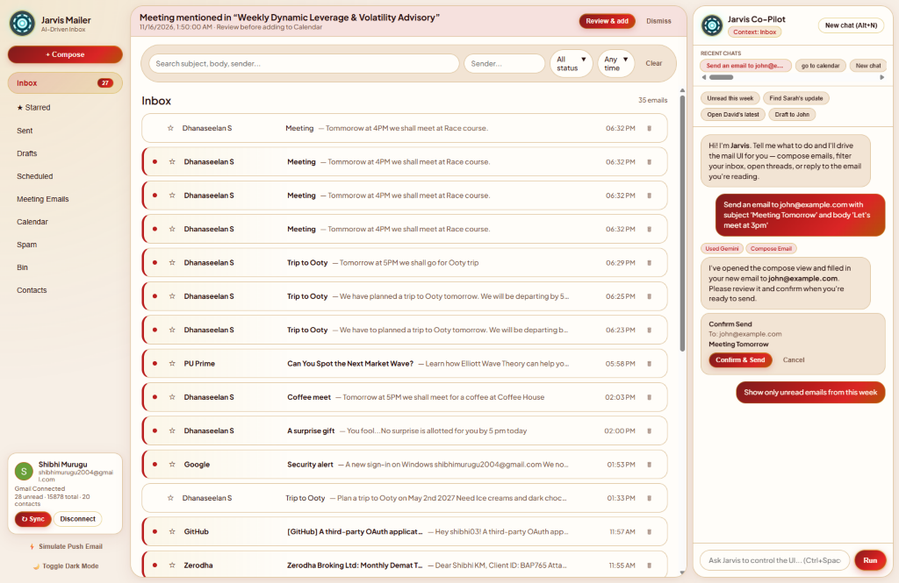 | 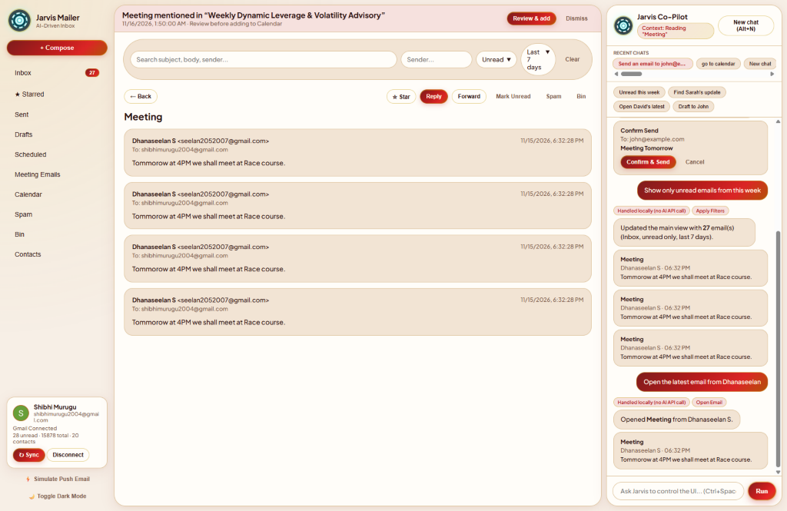 |
| **Context-aware: "Reply to this …"** | **Dark Mode** |
| 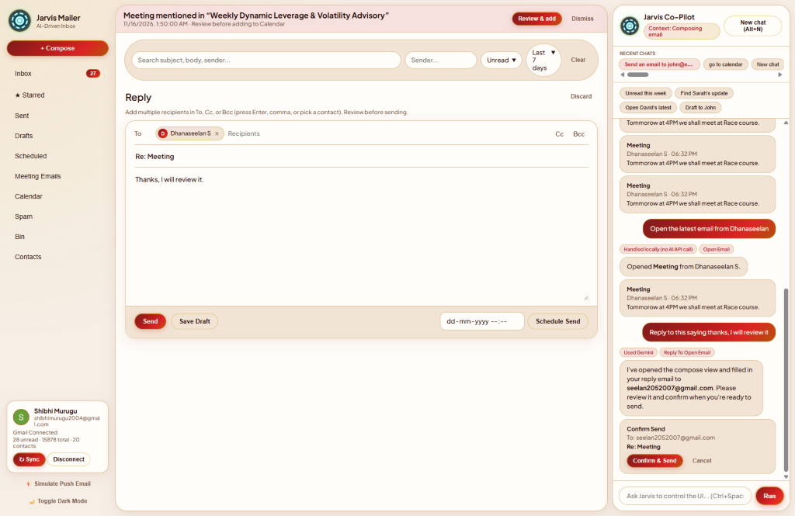 | 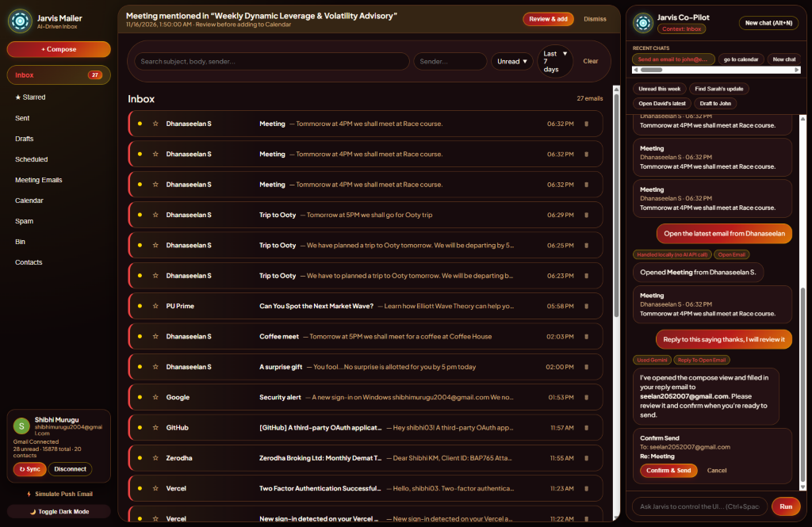 |

### Core Mail Pages

| Inbox | Email Detail / Thread |
|---|---|
| 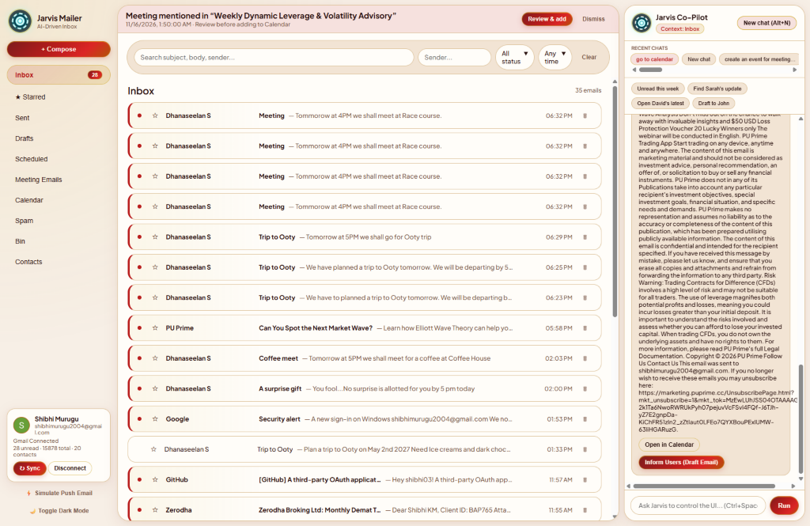 | 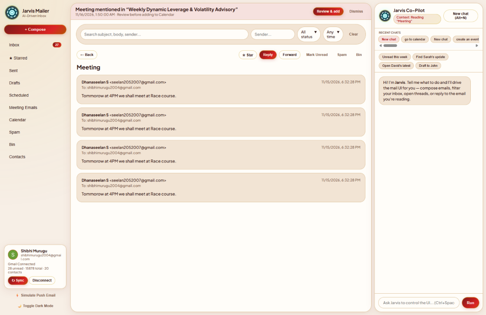 |
| **Compose** | **Calendar** |
| 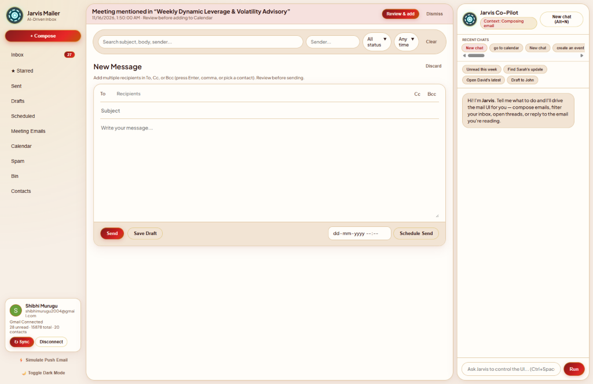 | 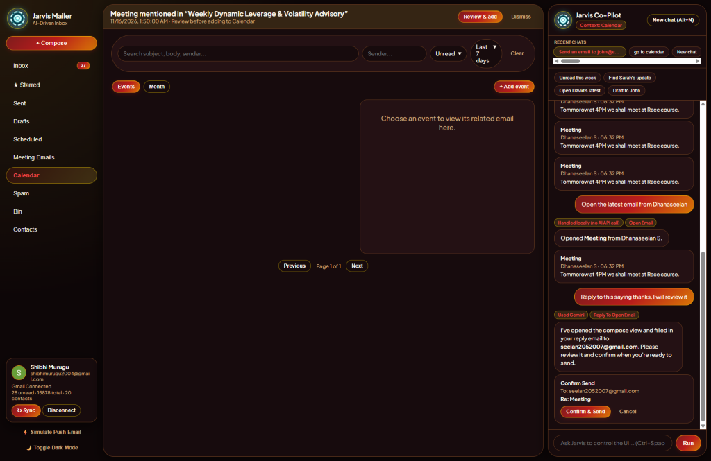 |
| **Contacts** | |
| 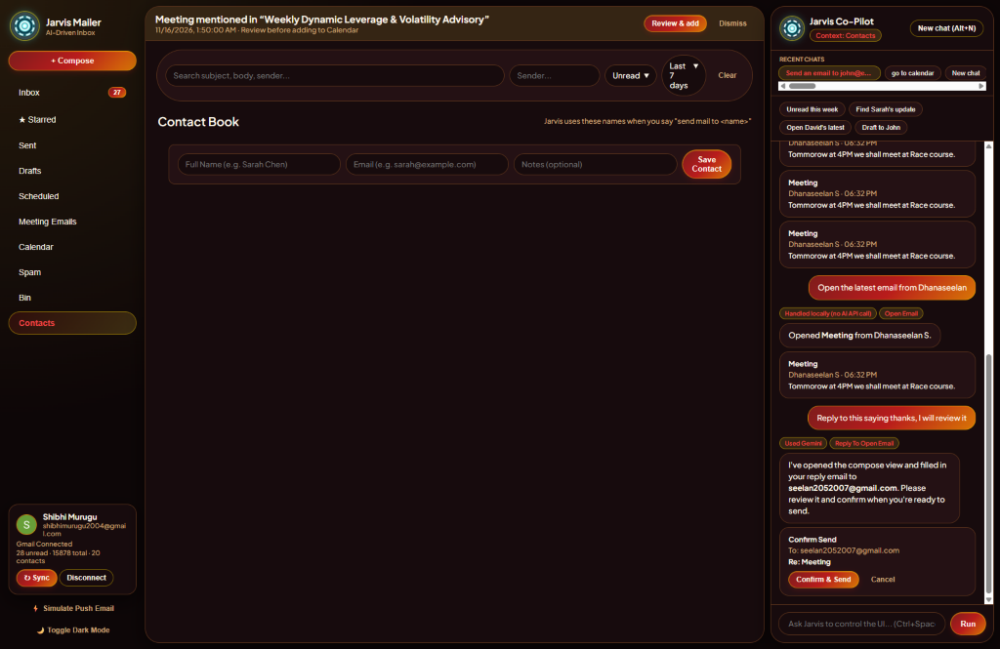 | |

---

## Local Setup

### 1. Prerequisites
- Python 3.12+
- `uv` or `pip`

### 2. Install & Run

```bash
git clone https://github.com/shibhi03/Jarvis-mailer.git
cd Jarvis-mailer

python -m venv .venv
# Windows:
.venv\Scripts\activate
# macOS/Linux:
# source .venv/bin/activate

pip install -r requirements.txt
cp .env.example .env

python manage.py migrate
python manage.py seed_demo_mail
python manage.py runserver
```

Open **http://127.0.0.1:8000/** in your browser. It runs immediately in **Demo Mode** with realistic seeded threads and full AI UI control.

### Deploy on Vercel with Supabase PostgreSQL

The app must use PostgreSQL on Vercel because serverless instances cannot rely on a local SQLite file. In the Vercel project, add `DATABASE_URL` under **Settings → Environment Variables** for every environment you deploy (Production, Preview, and/or Development). Copy the PostgreSQL connection string from Supabase's **Connect** panel and ensure it includes `sslmode=require`. Keep the password URL-encoded if it contains reserved characters. Use the Supabase connection option that matches your network; the session pooler is suitable when direct connections are unavailable.

After saving the variable, redeploy so the serverless functions receive it. Apply Django migrations to that same database before using the app (`python manage.py migrate` with `DATABASE_URL` set to the Supabase URL). Vercel deployments without `DATABASE_URL` now fail at startup with a configuration error instead of silently selecting SQLite.

### 3. Optional: Connect Real Gmail (OAuth2 + Pub/Sub) & LLM
Edit `.env` to enable live Gmail and choose one AI provider:

- **Gmail OAuth2**: Set `GOOGLE_CLIENT_ID`, `GOOGLE_CLIENT_SECRET`, and `GOOGLE_REDIRECT_URI=http://127.0.0.1:8000/auth/google/callback/`. Click **Connect Gmail** in the left rail.
- **Gmail Pub/Sub Push**: Set `GMAIL_PUBSUB_TOPIC=projects/<project>/topics/<topic>` and `GMAIL_WEBHOOK_TOKEN`. Point your Pub/Sub push subscription to `https://<your-domain>/api/webhooks/gmail/?token=<token>`.
- **AI provider**: Set `AI_PROVIDER=openai` or `AI_PROVIDER=gemini`, then set the matching `OPENAI_API_KEY` or `GEMINI_API_KEY`. Models default to `gpt-4o-mini` and `gemini-3.8-flash`; override them with `OPENAI_MODEL` or `GEMINI_MODEL`. Restart Jarvis after changing `.env`. Jarvis uses only the selected provider and reports its errors without trying the other provider. Deterministic UI controls such as navigation and filters still run locally.

### 4. Run Automated Tests

```bash
pytest -v
```

---

## High-Level Architecture

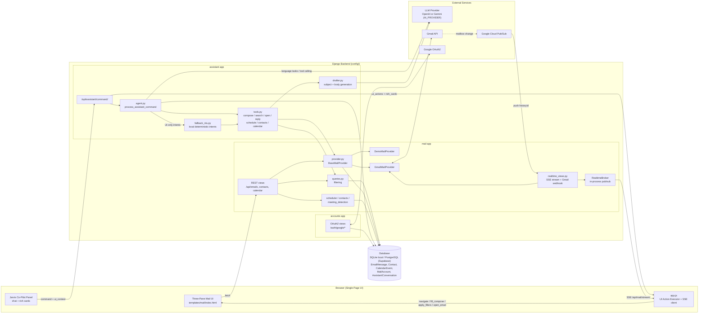

### Key Flows

| Flow | Path |
|---|---|
| **AI command** | Co-Pilot panel → `/api/assistant/command/` → `agent.py` (LLM tool calling, or `fallback_nlu.py` for UI-only intents) → `tools.py` → returns `ui_actions` + `rich_cards` → `app.js` drives the UI |
| **Mail CRUD** | UI → `mail/views.py` REST endpoints → `queries.py` / provider → DB (and Gmail API in live mode) |
| **Real-time sync** | Gmail → Pub/Sub → `/api/webhooks/gmail/` → `GmailMailProvider` incremental sync → `RealtimeBroker` → SSE → browser |
| **Auth** | `/auth/google/login/` → Google OAuth2 → callback stores tokens on `MailAccount` |

---

## API Endpoints

### Core

| Method | Endpoint | Description |
|---|---|---|
| GET | `/` | Main mail web app (SPA shell) |
| GET | `/healthz/` | Health check |
| — | `/admin/` | Django admin |

### Authentication (`accounts`)

| Method | Endpoint | Description |
|---|---|---|
| GET | `/auth/google/login/` | Start Google OAuth2 flow |
| GET | `/auth/google/callback/` | OAuth2 callback; stores Gmail credentials |
| POST | `/auth/logout/` | Disconnect Gmail account |
| GET | `/auth/status/` | Current auth / connection status |

### Emails (`mail`)

| Method | Endpoint | Description |
|---|---|---|
| GET | `/api/emails/` | List/filter emails (folder, sender, date range, unread, keyword) |
| GET | `/api/emails/<id>/` | Email detail with thread |
| POST | `/api/emails/send/` | Send an email (new, reply, or forward) |
| POST | `/api/emails/draft/` | Save a draft |
| POST | `/api/emails/schedule/` | Schedule an email for later delivery |
| POST | `/api/emails/<id>/toggle-read/` | Mark read / unread |
| POST | `/api/emails/<id>/star/` | Star / unstar |
| POST | `/api/emails/<id>/move/` | Move to a folder (e.g. bin, inbox) |
| POST | `/api/emails/bin/clear/` | Empty the bin |
| POST | `/api/emails/sync/` | Trigger a manual sync with the provider |
| GET | `/api/meetings/` | Emails containing detected meeting times |

### Contacts (`mail`)

| Method | Endpoint | Description |
|---|---|---|
| GET, POST | `/api/contacts/` | List or create contacts |
| PUT, PATCH, POST, DELETE | `/api/contacts/<id>/` | Update or delete a contact |

### Calendar (`mail`)

| Method | Endpoint | Description |
|---|---|---|
| GET, POST | `/api/calendar/events/` | List or create calendar events |
| GET, PUT, PATCH, POST, DELETE | `/api/calendar/events/<id>/` | Retrieve, update, or delete an event |
| GET | `/api/calendar/reminders/` | Due event reminders |
| POST | `/api/calendar/reminders/<id>/ack/` | Acknowledge a reminder |

### Real-Time (`mail`)

| Method | Endpoint | Description |
|---|---|---|
| GET | `/api/mail/stream/` | Server-Sent Events stream of incoming mail |
| POST | `/api/mail/simulate-incoming/` | Simulate an incoming email (Demo Mode) |
| POST | `/api/webhooks/gmail/?token=<token>` | Gmail Cloud Pub/Sub push webhook |

### Assistant (`assistant`)

| Method | Endpoint | Description |
|---|---|---|
| POST | `/api/assistant/command/` | Process a natural-language command; returns `reply`, `ui_actions`, `rich_cards` |
| GET | `/api/assistant/chats/` | List assistant conversations |
| POST | `/api/assistant/chats/new/` | Start a new conversation |
| GET | `/api/assistant/chats/<id>/` | Conversation history |

---

## Architecture Decisions & Trade-offs

1. **Declarative UI Action Protocol (`ui_actions` + `rich_cards`)**:
   - Instead of returning plain chat text, `/api/assistant/command/` returns structured `ui_actions` (`navigate_view`, `fill_compose`, `apply_filters`, `open_email`) and `rich_cards` (`email_preview`, `send_confirmation`).
   - **Trade-off**: Keeping the action executor in vanilla JS (`static/js/app.js`) avoids a heavy React/CopilotKit build step while keeping the UI deterministic, inspectable, and easy to extend.
2. **Mail Provider Abstraction (`BaseMailProvider`)**:
   - `DemoMailProvider` and `GmailMailProvider` implement the same interface (`sync_messages`, `send_message`, `mark_read`) backed by a unified Django `EmailMessage` store.
   - **Trade-off**: Caching messages in SQLite/Postgres enables fast, uniform filtering (`mail/services/queries.py`) across both Demo and Gmail modes without hitting rate limits on every keystroke.
3. **Real-Time Sync via Pub/Sub Webhook + SSE**:
   - We chose **Server-Sent Events (SSE)** (`StreamingHttpResponse` + in-process `RealtimeBroker`) over Django Channels + Redis.
   - **Trade-off**: SSE requires zero extra infrastructure (no Redis broker) and works out of the box on single-instance deployments (Render/Railway). For multi-worker horizontal scaling, `RealtimeBroker` would be swapped for Redis Pub/Sub.
4. **Selectable AI provider (LLM Tool Calling + Deterministic UI Controls)**:
   - `AI_PROVIDER` selects OpenAI or Gemini for language tasks. UI-only actions run through the local NLU without calling either API.

---

## What I'd Improve With More Time

- **Redis-backed SSE / Channels** for multi-worker production scaling.
- **Rich HTML email sanitization** (e.g., `bleach` + sandboxed `<iframe>`) for complex marketing/HTML emails from Gmail.
- **Streaming token-by-token assistant responses** and multi-step tool chaining (e.g., *"Find Sarah's latest email, summarize it, and draft a reply"*).
- **End-to-end Playwright browser tests** to assert animated compose filling and SSE DOM updates in a real browser.
