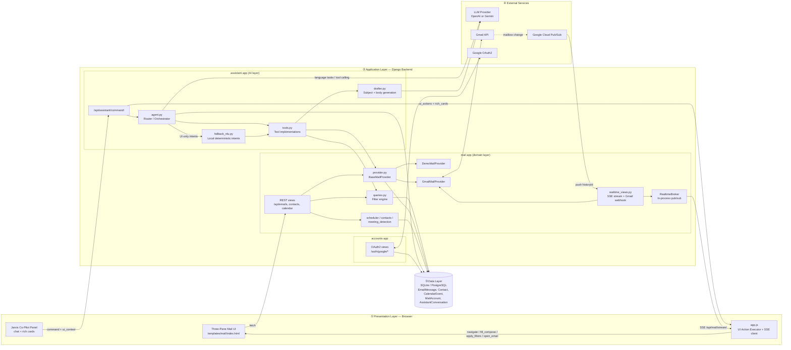
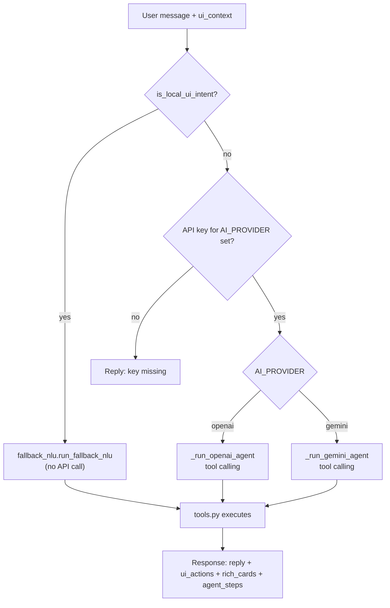
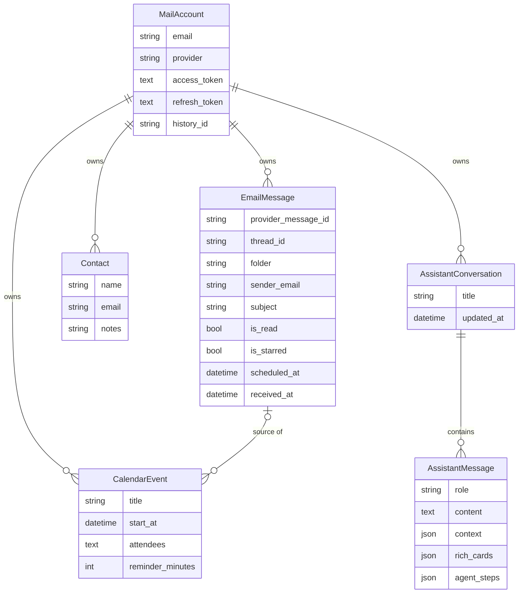
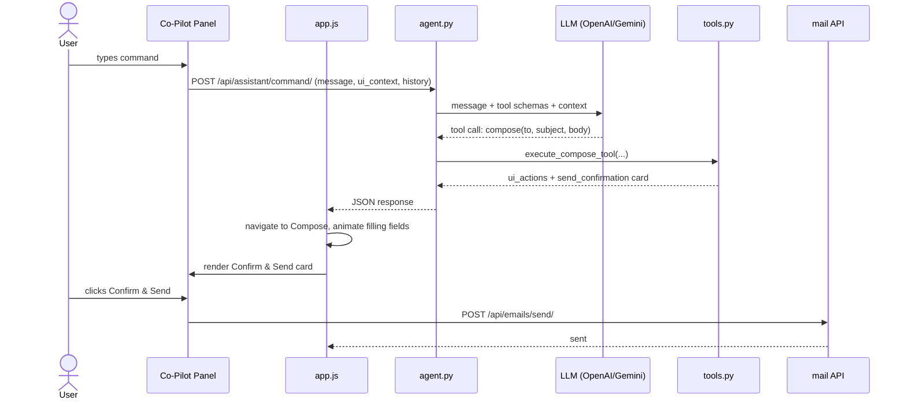
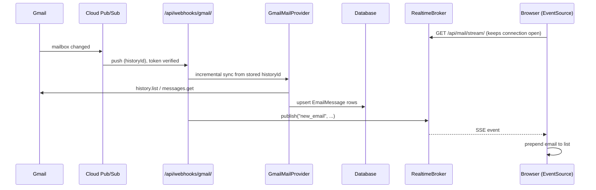
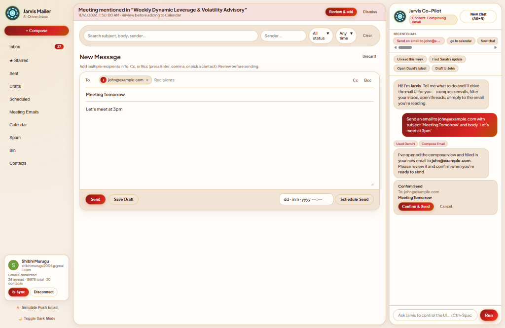
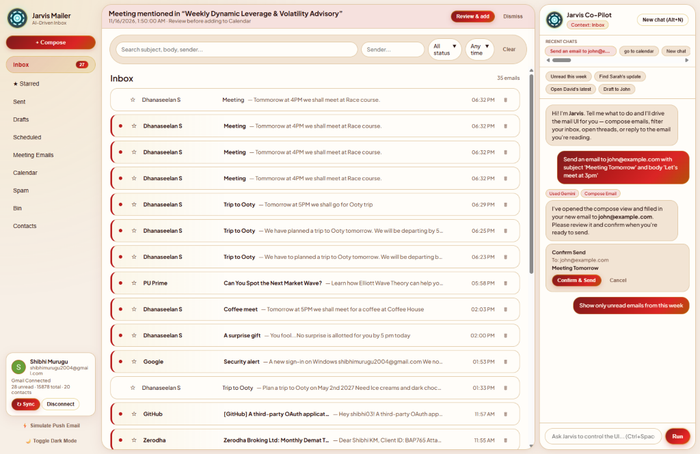
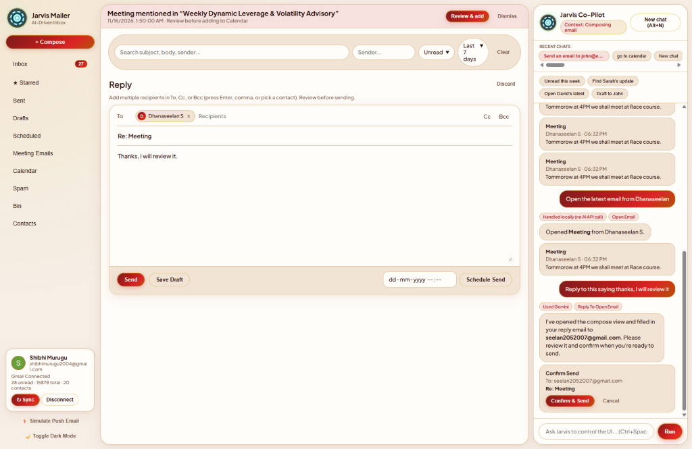
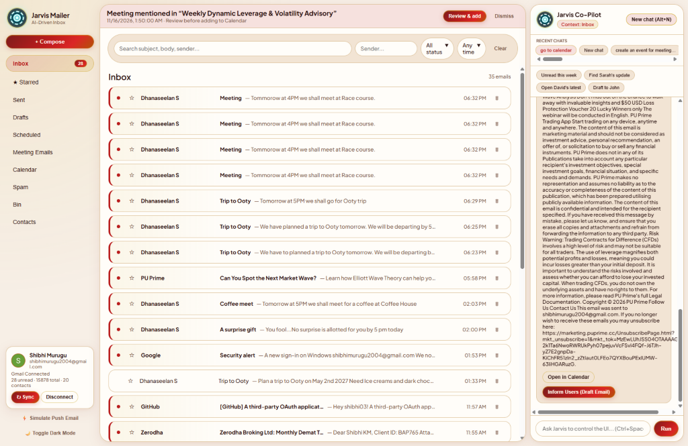

# Jarvis Mailer — Project Documentation

> An AI-driven email client where an embedded assistant, **Jarvis Co-Pilot**, does more than chat: it **operates the user interface** — navigating views, visibly filling forms, filtering the inbox, opening threads, and drafting context-aware replies.

- **Live demo:** https://jarvis-mailer.vercel.app/
- **Video walkthrough:** [Google Drive](https://drive.google.com/file/d/1alsHlwThjvRA4NSp6Th8v0rBmeCq0LJc/view?usp=sharing)

---

## 1. Project Overview

### 1.1 Problem

Traditional email clients force users to click through menus, type search filters, and write every message by hand. Most "AI email assistants" bolt a chatbot onto the side that returns text, leaving the user to copy-paste results into the actual UI.

### 1.2 Solution

Jarvis Mailer treats the AI assistant as a **UI operator**. When a user types *"Show only unread emails from this week"*, the assistant does not reply with a list in the chat — it **changes the filter controls and refreshes the main inbox**, exactly as if the user had done it manually. When asked to send an email, it **opens Compose and animates filling the fields**, then asks for confirmation before anything is sent.

### 1.3 Key Capabilities

| Area | Capability |
|---|---|
| **Mail client** | Inbox, Sent, Starred, Drafts, Scheduled, Spam, Bin; thread view; compose, reply, forward; read/unread, star, move |
| **AI Co-Pilot** | Natural-language compose, search & filter, navigation, context-aware reply/forward, draft rewriting, contact and calendar management |
| **Human-in-the-loop** | Sending always requires an explicit **Confirm & Send** click in a rich card |
| **Real-time** | Gmail push notifications (Cloud Pub/Sub) streamed to the browser over Server-Sent Events |
| **Productivity** | Scheduled send, meeting-time detection in emails, calendar events with reminders, contact book |
| **Modes** | **Demo Mode** (seeded data, no external accounts) and **Gmail Mode** (OAuth2-connected real mailbox) |

### 1.4 Technology Stack

| Layer | Technology |
|---|---|
| Backend | Python 3.12, Django 5.1 |
| Frontend | Django template + vanilla JavaScript (`static/js/app.js`) + CSS |
| AI | OpenAI (`gpt-4o-mini`) **or** Google Gemini, selected via `AI_PROVIDER` |
| Mail | Gmail API (`google-api-python-client`), Google OAuth2, Cloud Pub/Sub |
| Database | SQLite (local) / PostgreSQL on Supabase (production) via `dj-database-url` |
| Serving | Gunicorn + WhiteNoise; deployable to Render and Vercel |
| Testing | pytest + pytest-django |

---

## 2. Architecture Diagram



---

## 3. Architecture Explained

The system follows a classic **layered architecture** inside a single Django deployment, with four layers: presentation, application, data, and external services.

### ① Presentation Layer — Browser

A single page (`templates/mail/index.html`) rendered by Django and driven by `static/js/app.js`. It has three panes:

1. **Left rail** — folders, Compose, account status, Sync, dark-mode toggle.
2. **Center pane** — email list, thread view, compose form, calendar, contacts.
3. **Right pane** — the **Jarvis Co-Pilot** chat panel.

`app.js` has two responsibilities that make the architecture work:

- **UI Action Executor** — receives a list of declarative `ui_actions` from the backend and applies them to the DOM (switch view, type into compose fields with an animation, set filter dropdowns, open a specific email). The same functions are used by manual clicks and by the AI, so the AI can never do anything the user couldn't.
- **SSE client** — holds an `EventSource` connection to `/api/mail/stream/` and inserts new emails into the list the moment they arrive.

Every assistant request includes a **`ui_context`** snapshot: current view, currently open email, active filters, and any in-progress compose draft. This is what makes commands like *"Reply to this"* possible.

### ② Application Layer — Django Backend

Organized into three Django apps with clear boundaries:

#### `accounts` — Identity & Gmail connection
Runs the Google OAuth2 flow (`/auth/google/login/` → Google → `/auth/google/callback/`) and stores the access/refresh tokens on the `MailAccount` model. `/auth/status/` tells the UI whether Gmail is connected.

#### `assistant` — The AI layer

This is the core of the project. A request to `/api/assistant/command/` flows through:

| Component | Role |
|---|---|
| **`agent.py`** (orchestrator) | Entry point `process_assistant_command()`. Decides **how** to handle a message: locally or via the LLM. Builds a context summary from `ui_context` and conversation history. |
| **`fallback_nlu.py`** (local NLU) | Rule/regex-based intent parser for deterministic UI actions — navigation, filters, date ranges, opening emails, simple compose. Runs with **zero API calls**, so it is instant, free, and works even without an API key. |
| **LLM provider** | OpenAI or Gemini (chosen by `AI_PROVIDER`) using **function/tool calling**. Used only for language work: drafting, rewriting, summarizing, ambiguous requests. |
| **`tools.py`** | ~30 tool implementations (`execute_compose_tool`, `execute_search_tool`, `execute_open_email_tool`, `execute_reply_open_email`, calendar/contact tools, etc.). Each tool performs the backend work **and** returns the `ui_actions` / `rich_cards` the frontend should render. |
| **`drafter.py`** | Generates and revises subject + body text via the LLM, with a template fallback. |

**Routing logic (hybrid AI design):**



The response is a **declarative UI protocol**, not plain text:

```json
{
  "reply": "I've opened the compose view and filled in your email to john@example.com.",
  "ui_actions": [
    {"type": "navigate_view", "view": "compose"},
    {"type": "fill_compose", "to": "john@example.com", "subject": "Meeting Tomorrow", "body": "Let's meet at 3pm"}
  ],
  "rich_cards": [
    {"type": "send_confirmation", "to": "john@example.com", "subject": "Meeting Tomorrow"}
  ],
  "agent_steps": ["Used Gemini", "Compose Email"]
}
```

Conversations and their messages (including context, cards, and agent steps) are persisted in `AssistantConversation` / `AssistantMessage`, so chats can be resumed via `/api/assistant/chats/`.

#### `mail` — The domain layer

| Component | Role |
|---|---|
| **REST views** (`views.py`) | JSON endpoints for emails, contacts, calendar events, reminders, meetings. |
| **`provider.py`** | `BaseMailProvider` abstract interface (`sync_messages`, `send_message`, `mark_read`) with two implementations: **`DemoMailProvider`** (local DB only) and **`GmailMailProvider`** (Gmail API). `get_provider_for_account()` picks one based on the active `MailAccount`. |
| **`queries.py`** | A single `query_emails()` filter engine (folder, sender, keyword, date range, unread) shared by the UI **and** the AI tools — so AI-driven and manual filters always return identical results. |
| **`scheduler.py`** | Dispatches emails whose `scheduled_at` time has passed. |
| **`contacts.py`** | Upserts contacts from mail traffic and resolves names ("send to Sarah") into email addresses. |
| **`meeting_detection.py`** | Parses dates/times from email text to suggest calendar events ("Review & add" banner). |
| **`realtime.py`** | `RealtimeBroker` — thread-safe, in-process pub/sub with per-subscriber queues and heartbeats, feeding the SSE stream. |

### ③ Data Layer

All mail is **cached locally** in the `EmailMessage` table regardless of provider. This is a deliberate choice: filtering, searching, and AI tools run against the local DB, giving fast responses and avoiding Gmail API rate limits.



### ④ External Services

| Service | Used for |
|---|---|
| **OpenAI / Gemini** | LLM tool calling and text generation. Only the selected provider is used; there is no silent fallback to the other one. |
| **Google OAuth2** | Authorizing access to the user's Gmail. |
| **Gmail API** | Syncing messages (incremental via `historyId`), sending, marking read. |
| **Google Cloud Pub/Sub** | Push notifications when the mailbox changes. |

---

## 4. Key Flows

### 4.1 AI command: "Send an email to john@example.com …"



### 4.2 Real-time incoming mail



In Demo Mode, the **⚡ Simulate Push Email** button calls `/api/mail/simulate-incoming/`, which publishes the same event without needing Gmail or a public URL.

### 4.3 Manual UI actions

Regular clicks call the REST endpoints directly (`/api/emails/`, `/api/emails/<id>/star/`, etc.). These go through the **same** `queries.py` and provider layer as the AI tools.

---

## 5. Design Decisions & Trade-offs

| Decision | Why | Trade-off |
|---|---|---|
| **Declarative UI action protocol** (`ui_actions` + `rich_cards`) | The AI drives the UI through a small, inspectable set of actions; easy to test and extend; the AI can only do what the UI supports. | Frontend must implement an executor for each action type. |
| **Hybrid AI: local NLU + LLM** | Navigation and filters are instant, free, and deterministic; the LLM is reserved for language work. | Two code paths to maintain; regex intents can miss unusual phrasings. |
| **Provider abstraction** | Demo and Gmail modes share one code path; adding Outlook/IMAP later means one new class. | Local cache must be kept in sync with the remote mailbox. |
| **Local mail cache** | Fast uniform filtering; no rate limits on every keystroke. | Storage cost; possible short-lived staleness. |
| **SSE over WebSockets/Channels** | No Redis or ASGI channel layer needed; simple HTTP streaming. | One-way only; in-process broker does not share events across workers. |
| **Vanilla JS over React** | No build step; Django serves everything. | Less structure as the UI grows. |
| **Human-in-the-loop sending** | Prevents the AI from sending mail by mistake. | One extra click per send. |

---

## 6. Deployment

| Target | Notes |
|---|---|
| **Local** | `python manage.py migrate && python manage.py seed_demo_mail && python manage.py runserver` — runs in Demo Mode with SQLite. |
| **Render** | `render.yaml`: builds, collects static, migrates, seeds, then runs `gunicorn config.wsgi --workers 2 --threads 4`. |
| **Vercel** | Requires `DATABASE_URL` pointing at Supabase PostgreSQL (`sslmode=require`); startup fails fast if it is missing. |

Configuration is via environment variables (`.env`): `AI_PROVIDER`, `OPENAI_API_KEY` / `GEMINI_API_KEY`, `GOOGLE_CLIENT_ID`, `GOOGLE_CLIENT_SECRET`, `GOOGLE_REDIRECT_URI`, `GMAIL_PUBSUB_TOPIC`, `GMAIL_WEBHOOK_TOKEN`, `DATABASE_URL`.

> [!WARNING]
> `RealtimeBroker` lives in process memory. With multiple Gunicorn workers (Render config uses 2) or serverless instances (Vercel), a webhook may be handled by a different process than the one holding a browser's SSE connection, so some live events can be missed until the next sync. Moving the broker to Redis Pub/Sub fixes this.

---

## 7. Future Improvements

- Redis-backed broker (or Django Channels) for multi-worker real-time delivery.
- HTML email sanitization (`bleach`) and sandboxed rendering.
- Streaming token-by-token assistant responses and multi-step tool chaining.
- End-to-end Playwright tests for animated compose filling and SSE updates.

---

## 8. Screenshots

| Co-Pilot Compose | Co-Pilot Filter |
|---|---|
|  |  |
| **Co-Pilot Reply** | **Inbox** |
|  |  |

See the [README](../README.md#screenshots) for the full set.
